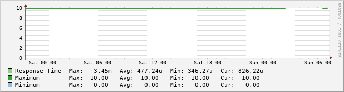

# Post Incident Review: hal rpc.mountd OOM Kill — Cluster-Wide Stale NFS Mounts and a 4-Hour Overnight Gap

## Executive Summary

At about 02:31 AEST on Sunday 15 November the Linux OOM killer on `hal` (QNAP NAS, 172.22.22.2, 256 MB RAM) killed `rpc.mountd`. It had grown to 520 MB virtual and 31 MB resident, about 12% of the machine's physical memory. Nothing restarted it. `nfsd` (port 2049) and the portmapper (port 111) stayed up, so hal looked healthy apart from one port. About 25 minutes later every hal NFS mount in `pvek8s` started returning `Stale file handle`: 20 mounts across k8s01, k8s02 and k8s03, covering `/Qmultimedia`, `/Qdownload`, `/backups` and four `nfs-csi` PVCs. With mountd gone, no client could remount. calibre crashed and could not be recreated for four hours, radarr, sabnzbd and trivy-server logged stale-handle errors, and the `/mnt/backups` target was dead on all three nodes.

Detection worked and response did not. The `nfs-mountd` check added after the 2026-08-01 incident went CRITICAL at 02:34 and named the exact port. `microk8s-nfs-stale-mounts` fired on all three nodes from 02:56 and linked the runbook. About 50 notifications reached Slack `#home-status`, and the stale-mounts alerts escalated to the `urgent` Zulip stream after an hour. All of them arrived overnight and none woke anyone. The owner noticed at 06:27, opened the incident with the new `sre-harness` `start-incident` skill, confirmed the picture through the Nagios MCP and read-only checks from k8s01, and restarted NFS on hal from the shell at about 06:33 (`/etc/init.d/nfs restart`). mountd came back, Nagios recovered at 06:34:55, and all 20 mounts revalidated by themselves. No remounts were needed.

A per-pod file-descriptor probe showed that only one process, `trivy-server-0`, still held a dead descriptor. The runbook's "restart every affected workload" step was narrowed to that one pod. Restarting it caused a second, smaller outage. trivy's vulnerability DB had not refreshed during the NFS outage, so the new pod needed a full 1.7 GB download to its `nfs-csi` cache. That download takes about 143 s, and the liveness probe allows about 105 s with no startupProbe. The pod crash-looped from 06:46. The first temporary fix (raise the liveness delay) was reverted by ArgoCD within seconds: only the parent app's `selfHeal` had been switched off, and its automated sync re-applied the child. The second attempt turned off the parent's automated sync completely. trivy was Ready at 07:05, and the ArgoCD configuration was then restored.

Three chains follow. (1) mountd was OOM-killed on an under-sized appliance with no memory monitoring and no supervisor. (2) Correct alerts reached nobody overnight and nothing auto-remediated a safe, known fix. (3) A remediation restart exposed a missing startupProbe and an undocumented ArgoCD override procedure. This is the third hal NFS incident since August ([2026-08-01](2026-08-01-hal-nfs-export-failure-stale-mounts.md), [2026-08-15](2026-08-15-hal-nfs-handle-invalidation-silent-sqlite-failures.md)), and the first where the reason mountd died is known.

---

## Timeline (AEST — UTC+10)

| Time             | Event                                                                                                                                                                                             |
| ---------------- | ------------------------------------------------------------------------------------------------------------------------------------------------------------------------------------------------- |
| **02:30:54**     | Last OK result for hal `nfs-mountd` (TCP 30000).                                                                                                                                                 |
| **~02:31**       | hal kernel: `Out of memory: Kill process 24832 (rpc.mountd) score 622` / `Killed process 24832 (rpc.mountd) total-vm:520116kB, anon-rss:31852kB`. Time mapped from the dmesg timestamp offset against the 06:33 restart line. |
| **02:34:54**     | `nfs-mountd` HARD CRITICAL: `connect to address 172.22.22.2 and port 30000: Connection refused`. Slack `#home-status` notification #1.                                                         |
| **02:56:00**     | `microk8s-nfs-stale-mounts` CRITICAL on k8s03 (4/6 mounts stale). k8s02 follows at 02:57 (13/13), k8s01 at 03:05 (`/mnt/backups`). Repeats every 15 min on all nodes.                         |
| **~02:56**       | calibre container exits. kubelet cannot recreate it: 951× `CreateContainerError: failed to generate container spec` over the next 4h 12m.                                                       |
| **03:34 – 05:34**| `nfs-mountd` re-notifies hourly (#2–#4). Stale-mounts alerts escalate to the `urgent` Zulip contact after 60 min per `escalations.cfg` (escalation inferred from config, not checked in Zulip).                                       |
| **06:27**        | Owner notices that NFS on hal has stopped and asks for an incident to be opened with the sre-harness.                                                                                            |
| **06:28**        | Incident record pgmac-net/incidents#97 opened (P3 provisional). Nagios MCP `get_service_status(hal)` confirms `nfs-mountd` CRITICAL, `nfs-nfsd` and `nfs-rpcbind` OK. `get_unhandled_problems` does **not** list it (tooling bug, see Chain 2). |
| **06:28**        | Runbook matched: `hal-nfs-export-failure.md` Mode 1, with the difference that only port 30000 is refused, not 111.                                                                               |
| **06:30**        | From k8s01: `rpcinfo -t hal nfs 3` ready; `showmount -e` → `RPC: Unable to receive; errno = Connection refused`; ports 111/2049 open, 30000 refused. A privileged stat sweep finds all 20 hal mounts stale. Severity → P2. The advisory helper suggested P1 (0.91); not followed. |
| **06:30**        | Pre-fix evidence captured: nagiosgraph of `nfs-mountd`.                                                                                                                                           |
| **~06:33**       | Owner runs `/etc/init.d/nfs restart` on hal (person-run; approval recorded).                                                                                                                       |
| **06:33 – 06:34**| Verified from k8s01: `showmount -e` lists all exports, port 30000 open, a fresh read-only mount of `/Qmultimedia` works. Re-sweep: **all 20 mounts OK**, no remount needed.                    |
| **06:34**        | fd probe across the 9 affected pods: only `trivy-server-0` PID 1 holds a dead descriptor (`fanal.db`). sabnzbd `history1.db` `quick_check` = `ok`.                                              |
| **06:34:55**     | Nagios `nfs-mountd` RECOVERY (HARD OK). calibre recreates successfully at ~06:35.                                                                                                                |
| **06:45**        | Owner approves restarting trivy. `kubectl rollout restart statefulset/trivy-server`.                                                                                                              |
| **06:46**        | New trivy pod downloads its DB (`Need to update DB`), is killed by the liveness probe (exit 137) mid-download, and starts again. Crash loop.                                                     |
| **06:57**        | Owner chooses option C: temporary probe override now, permanent fix as pgmac-net/pgk8s#1108. `selfHeal` turned off on apps `sec` (parent) and `trivy-server`, liveness `initialDelaySeconds` patched 5 → 300. |
| **06:57:52**     | ArgoCD runs an automated sync of `sec` anyway, re-applies `trivy-server` with `selfHeal: true`, and the child sync at 06:58:00 reverts the probe. Still crash-looping (5 restarts).              |
| **07:01**        | Owner approves option 1: `sec` automated sync removed entirely, then child `selfHeal` off, probe patched (verified held), pod deleted so the StatefulSet recreates it from the new template.      |
| **07:02:45 – 07:05:08** | DB downloaded in 143 s. trivy `Listening 0.0.0.0:4954`, Ready.                                                                                                                           |
| **07:05:15**     | `sec` restored to `automated {prune, selfHeal}`. ArgoCD reverts the child app and the probe. The pod rolls once and starts in 3 s on the fresh DB. Synced/Healthy.                                    |
| **07:10**        | Final verification: Nagios clean for hal, 0 stale mounts on any node, all endpoints responding, every ArgoCD app Synced/Healthy. Incident resolved.                                             |

---

## Root Causes

### The Infinite How's Chain

> _"The infinite how's" methodology: at each causal step, ask "how?" rather than accepting
> the surface answer. Keep drilling until reaching an actionable, preventable cause._

---

#### Chain 1: Every hal NFS Mount Went Stale — rpc.mountd OOM-Killed on an Under-Sized NAS

##### How did 20 NFS mounts on three nodes all return `Stale file handle`?

The Linux kernel `nfsd` on hal could no longer validate the file handles clients presented. `nfsd` was **not** restarted at 02:31: the only `nfsd: last server has exited` line in dmesg is the 06:33 manual restart. So this was not the 2026-08-01 re-export mechanism.

##### How can a running nfsd reject handles it issued?

The kernel NFS server keeps export and client-authorisation caches (`auth.unix.ip`, `nfsd.fh`, `nfsd.export`) that it fills by upcall to the userspace `rpc.mountd`. Each entry has an expiry. When an entry expires, nfsd asks mountd again. With no mountd to answer, lookups for that client or export fail and clients get `ESTALE`. This is an inference from documented nfsd behaviour, and the evidence fits it closely. Mounts went stale 25 minutes after the kill (first stale-mount alert at 02:56), not at once, and staggered by node. When mountd came back at 06:33 every mount revalidated **without a remount**, which a real re-export (new handles) would not allow.

##### How did mountd die?

The OOM killer chose it: `Killed process 24832 (rpc.mountd) total-vm:520116kB, anon-rss:31852kB, file-rss:588kB`, OOM score 622, the highest on the box. hal has 255,596 kB of RAM and 512 MB of swap. The restarted mountd is about 2.6 MB VSZ.

##### How did mountd become the biggest process on the NAS?

It had been running since the NFS restart during the 2026-08-01 incident, about 106 days. Growing from about 2.6 MB to 520 MB virtual over that time points to unbounded growth in mountd itself (cache or leak) on this firmware (QNAP, armv5tel, kernel 3.4.6, built 2024-06). That is an inference: there is no history of mountd's size to prove the curve. What triggered the OOM at 02:31 is unknown. The kernel ring buffer had wrapped by 07:15 and the OOM header (triggering process, memory state) was gone.

##### How was the memory pressure not seen before it killed mountd?

hal's Nagios checks are TCP port probes only (`hal-http`, `hal-https`, `hal-smb`, `hal-ssh`, `nfs-mountd`, `nfs-nfsd`, `nfs-rpcbind`). Nothing watches memory, swap or process size on hal, and hal has no NRPE agent. The 2026-08-01 PIR established *that* mountd and the portmapper could die while nfsd lived, but not *why*, so nothing pointed at memory.

##### How did a killed mountd stay dead for four hours?

QNAP's init does not supervise `rpc.mountd`. It is started once by `/etc/init.d/nfs` and never respawned. No Nagios event handler exists for `nfs-mountd`, although its fix (start mountd again) is safe and was already documented.

**Root cause:** a critical single-instance daemon on an under-sized storage appliance had no memory monitoring, no supervision and no automatic restart. → nagios-config#68 (auto-restart), nagios-config#70 (memory monitoring), homelabia#250 (growth and replacement decision).

---

#### Chain 2: Correct Alerts for Four Hours, No Action — Overnight Delivery Without Escalation or Remediation

##### How did a correctly detected outage run for ~3h 53m before anyone acted?

Every alert was delivered to channels that nobody reads at 02:30–06:30 on a Sunday: Slack `#home-status` (about 50 notifications), plus the `urgent` Zulip stream for the stale-mounts check after 60 minutes.

##### How did the most specific alert not escalate?

`escalations.cfg` (built for nagios-config#46 after the 2026-08-06 17-hour gap) escalates `microk8s-nfs-stale-mounts`, `microk8s-ro-pvc-mounts` and `microk8s-storage-kernel-errors`. The hal-side `nfs-mountd`, `nfs-rpcbind` and `nfs-nfsd` checks were added in nagios-config#32 and never joined that set. The alert that named the cause repeated hourly at routine urgency.

##### How did escalation still not wake anyone?

The `urgent` contact is a Zulip stream: a separate channel, not a page. There is no defined policy for which tier-1 failures should wake the single operator, which should be auto-remediated, and which can wait until morning. The catalog marks `nfs-storage` as tier 1, but nothing in the alerting path uses tiers.

##### How did responders' tooling understate the problem once someone looked?

During triage, the Nagios MCP's `get_unhandled_problems` returned only two **acknowledged** HDD warnings and omitted the unacknowledged `nfs-mountd` CRITICAL and the pve2 RAID-controller WARNING. `get_service_status` was correct. The cross-check was only made because the user had already said what was broken. A responder or agent relying on "unhandled problems" would have seen a quiet system.

**Root cause:** alert routing does not map service tier to an overnight response (page, auto-remediate or wait), and the hal NFS checks were left out of the escalation added after the last detection gap. → homelabia#251 (overnight policy), nagios-config#69 (escalation set), nagios-config#68 (auto-remediation), nagios-mcp#8 (tool bug).

---

#### Chain 3: trivy Crash Loop After Remediation — No startupProbe, Cache on NFS, and an ArgoCD Override That Didn't Hold

##### How did restarting one pod cause a 19-minute outage of that service?

The new trivy pod had to download its full vulnerability DB at startup (`[vulndb] Need to update DB`). The liveness probe killed it mid-download (exit 137) and each restart began the download again.

##### How did the download outlast the probe?

The DB is 1.7 GB uncompressed and is written to the `nfs-csi` cache on hal at about 14 MB/s, so it took 143 s. The liveness probe allows `initialDelaySeconds: 5` + `failureThreshold: 10` × `periodSeconds: 10` ≈ 105 s, and there is no startupProbe. In steady state this never matters: the running server refreshes the DB in the background. It only matters on a cold start with a stale DB, which is exactly the state the NFS outage left behind (trivy logged `open trivy.db: stale file handle` throughout).

##### How was the probe not tunable?

The Helm chart `aquasecurity/trivy` 0.7.0 exposes no probe values, so the fix cannot be made in the Application's `valuesObject`. → pgk8s#1108.

##### How did the first temporary override get reverted?

`sec` is an app-of-apps that owns the `trivy-server` Application. Setting `selfHeal: false` on `sec` left `automated` sync on. Patching the child made `sec` OutOfSync, and ArgoCD ran an automated sync of `sec` two seconds later (06:57:52). That re-applied `trivy-server` with `selfHeal: true`, and the child's own sync reverted the StatefulSet. The responder's memory notes said "pause the parent", which was correct but not specific enough. A separate trap followed: a StatefulSet will not roll a pod that has never been Ready, so even a held patch needs a manual pod delete.

##### How was there no procedure for this?

Temporary overrides of ArgoCD-managed workloads come up repeatedly (Jiva volume moves, this incident) and were documented only in a personal memory note. There was no runbook. → this PR adds [ArgoCD App-of-Apps Temporary Override](../runbooks/argocd-app-of-apps-temporary-override.md).

**Root cause:** a workload with a long, unbounded startup task had no startupProbe and kept its cache on the NFS storage that had just failed, and the procedure for temporarily overriding ArgoCD-managed config was undocumented. → pgk8s#1108, new runbook.

---

## Impact

### Services Affected

| Service                              | Impact                                                                                     | Duration                |
| ------------------------------------ | ------------------------------------------------------------------------------------------ | ----------------------- |
| hal NFS (`nfs-storage`, tier 1)      | mountd down; no new mounts; all existing mounts stale                                      | ~4h 04m (02:31 → 06:34) |
| calibre (media)                      | Container exited and could not be recreated (`CreateContainerError`)                      | ~3h 39m (02:56 → 06:35) |
| radarr, sabnzbd (media)              | ESTALE errors (`Mono.Unix.UnixIOException: Stale file handle`, `OSError: [Errno 116] … /downloads/sabnzbd/nzb/`) | ~3h 37m |
| sonarr, readarr, linkace, linkace-scheduler, calibre-web | Storage stale behind Ready pods; no errors logged                              | ~3h 37m                 |
| trivy-server (sec)                   | DB/cache stale during outage; then crash loop and fully down                               | ~3h 37m degraded + 19m down (06:46 → 07:05) |
| vaultwarden (sec)                    | Config PVC stale; vault DB is external, so it was not at risk                              | ~3h 37m                 |
| `/mnt/backups` on k8s01–03           | Backup target unreachable                                                                  | ~3h 37m                 |

### Duration

- **Total incident window:** ~4h 34m (02:31 → 07:05)
- **Time to human awareness:** ~3h 53m (02:34 first alert → 06:27)
- **Active remediation:** ~38m (06:27 → 07:05), of which NFS itself took ~7m and the trivy follow-on ~19m
- **Expected recovery time (with documented procedure):** ~5 min, or about one check interval with the event handler in nagios-config#68

### Scope

- hal (172.22.22.2) and every pvek8s node: k8s01 (`/mnt/backups` only), k8s02 (13 mounts), k8s03 (6 mounts)
- Data loss: none found. sabnzbd `history1.db` passed `PRAGMA quick_check`. Writes attempted during the window failed and were not retried.
- User-visible: media apps degraded overnight, calibre down, image scanning down for 19 minutes. Home Assistant was not on a stale mount.
- One unexplained observation: `https://linkace.int.pgmac.net/` returns HTTP 400 with its own page and no storage errors. It was not checked against a pre-incident baseline.

---

## Resolution Steps Taken

### Phase 1: Open the record and establish the picture

1. Opened pgmac-net/incidents#97 with `incident.py open` before diagnosing. Three other incidents were open, all unrelated Jiva/calico problems, so this was opened with `--new`.
2. Nagios MCP `get_service_status(host_name="hal")`: `nfs-mountd` CRITICAL, everything else on hal OK.
3. RPC-layer checks from k8s01:

    ```bash
    rpcinfo -t hal.int.pgmac.net nfs 3
    # → program 100003 version 3 ready and waiting     (nfsd alive)
    timeout 10 showmount -e hal.int.pgmac.net
    # → rpc mount export: RPC: Unable to receive; errno = Connection refused
    for p in 111 2049 30000; do timeout 4 bash -c "echo >/dev/tcp/172.22.22.2/$p" 2>/dev/null && echo "$p OPEN" || echo "$p refused"; done
    # → 111 OPEN / 2049 OPEN / 30000 refused
    ```

4. Privileged stat sweep on all three nodes (runbook Detection): all 20 hal mounts `Stale file handle`. Pod UIDs from the mount paths mapped to 10 workloads.

### Phase 2: Fix NFS

1. Owner ran `/etc/init.d/nfs restart` on hal. The runbook's documented path is the QNAP UI toggle; the CLI worked as well.
2. Verified `showmount -e` lists all exports, port 30000 open, and a fresh read-only mount of `/Qmultimedia` works.
3. Re-ran the sweep: all mounts OK. The runbook's remount steps (Mode 1, steps 3–4) were not needed.

### Phase 3: Find processes still holding dead descriptors

1. Instead of the runbook's blanket restart, opened every NFS-path descriptor in each affected pod:

    ```bash
    kubectl --context pvek8s -n <ns> exec <pod> -- sh -c 'for p in $(ls /proc | grep -E "^[0-9]+$"); do for f in /proc/$p/fd/*; do t=$(readlink $f 2>/dev/null); case "$t" in /config*|/downloads*|/media*|/books*|/data*|/home/scanner*) dd if=$f bs=1 count=0 2>&1 | grep -qi stale && echo "STALE pid=$p $t";; esac; done; done'
    # → only trivy-server-0: STALE pid=1 /home/scanner/.cache/trivy/fanal/fanal.db
    ```

2. Checked the highest-risk SQLite database with a fresh read-only connection: sabnzbd `history1.db` → `('ok',)`.

### Phase 4: trivy

1. `kubectl rollout restart statefulset/trivy-server` (approved). This cleared the dead descriptor but started the crash loop described in Chain 3.
2. First override attempt (parent `selfHeal: false` only) was reverted by ArgoCD within 8 s.
3. Second attempt, following the new runbook: removed `sec` `automated` → verified no new sync → child `selfHeal: false` → JSON-patched `livenessProbe.initialDelaySeconds` 5 → 300 → verified it held → deleted the pod (a StatefulSet will not roll a never-Ready pod) → waited for Ready (DB downloaded in 143 s) → restored `sec` `automated {prune: true, selfHeal: true}`. ArgoCD reverted the probe and the pod restarted in 3 s on the fresh DB.



*Nagios `nfs-mountd` on hal (TCP 30000), day view anchored 07:10 AEST. The series stops at ~02:30 when the OOM killer took mountd and resumes at ~06:35 after the manual restart. The gap is the outage: the check emits no perfdata while the port is refused.*

---

## Verification

```bash
# Nagios: hal clean
# mcp__nagios__get_service_status(host_name="hal", service_description="nfs-mountd")
# → TCP OK - 0.000 second response time on 172.22.22.2 port 30000 (HARD OK since 06:34:55)

# No stale mounts on any node
for n in k8s01 k8s02 k8s03; do ssh $n 'mount -t nfs,nfs4 | awk "{print \$3}" | while read m; do timeout 6 sudo -n stat "$m" >/dev/null 2>&1 || echo STALE; done | grep -c STALE'; done
# → 0 / 0 / 0

# trivy healthy, no dead descriptors, back on chart defaults
curl -s -o /dev/null -w "%{http_code}\n" https://trivy.int.pgmac.net/healthz
# → 200
kubectl --context pvek8s -n sec get pod trivy-server-0 -o jsonpath='{.spec.containers[0].livenessProbe.initialDelaySeconds} {.status.containerStatuses[0].ready}'
# → 5 true

# Endpoints
for u in sonarr radarr readarr sabnzbd books warden; do curl -s -o /dev/null -w "$u %{http_code}\n" -m 20 -k https://$u.int.pgmac.net/; done
# → 302 302 302 303 200 200

# ArgoCD
kubectl --context pvek8s -n argocd get applications --no-headers | awk '$2!="Synced"||$3!="Healthy"'
# → (empty)
```

---

## Preventive Measures

### Immediate Actions Required

1. **Auto-restart rpc.mountd on hal** (High)
    - Chain 1 and 2: the fix is a safe restart, and four hours passed because nobody was awake to run it.
    - Issue: [pgmac-net/nagios-config#68](https://github.com/pgmac-net/nagios-config/issues/68)
2. **Define an overnight policy for tier-1 alerts** (High)
    - Chain 2: about 50 correct notifications and an escalation reached nobody.
    - Issue: [pgmac-net/homelabia#251](https://github.com/pgmac-net/homelabia/issues/251)
3. **Add hal NFS checks to the escalation set** (Medium)
    - Chain 2: the alert that named the cause never escalated.
    - Issue: [pgmac-net/nagios-config#69](https://github.com/pgmac-net/nagios-config/issues/69)
4. **Fix `get_unhandled_problems` in the Nagios MCP** (Medium)
    - Chain 2: incident tooling hid the CRITICAL it was meant to surface.
    - Issue: [pgmac-net/nagios-mcp#8](https://github.com/pgmac-net/nagios-mcp/issues/8)
5. **Give trivy-server a startupProbe and move its cache off nfs-csi** (Medium)
    - Chain 3.
    - Issue: [pgmac-net/pgk8s#1108](https://github.com/pgmac-net/pgk8s/issues/1108)

### Longer-Term Improvements

6. **Monitor hal memory, swap and per-process RSS; alert on OOM kills** (Medium)
    - Chain 1: no visibility of the pressure, and the OOM evidence was lost with the ring buffer.
    - Issue: [pgmac-net/nagios-config#70](https://github.com/pgmac-net/nagios-config/issues/70)
7. **Measure mountd growth on hal; decide on scheduled restart or replacing the NAS** (Medium)
    - Chain 1: a 256 MB armv5 appliance backs a tier-1 service.
    - Issue: [pgmac-net/homelabia#250](https://github.com/pgmac-net/homelabia/issues/250)
8. **sre-harness audit: quote-insensitive approval pairing, fewer false mutation flags** (Medium)
    - Incident process: 28 "unauthorised mutations" were reported, almost all false (see Audit Log).
    - Issue: [pgmac-net/claude-plugins#32](https://github.com/pgmac-net/claude-plugins/issues/32)
9. **Catalogue nfs-storage consumers; resolve its unverified dependencies** (Low)
    - Catalog finding: blast radius had to be rebuilt from mount sweeps.
    - Issue: [pgmac-net/sre-catalog#11](https://github.com/pgmac-net/sre-catalog/issues/11)

---

## Lessons Learned

### What Went Well

- **The checks added after 2026-08-01 worked.** `nfs-mountd` fired within four minutes and named the port, and `microk8s-nfs-stale-mounts` fired on every node with the runbook link in its output. Detection is no longer the gap.
- **The record was open before diagnosis.** The timeline holds 25 typed entries written as things happened. This PIR was written from that export rather than from memory.
- **The runbook's detection commands identified the failure in minutes**, and its privileged-sweep warning prevented the `Permission denied` false positive.
- **The fd probe turned "restart everything" into "restart one pod".** Eight of nine workloads recovered with no restart at all.
- **Gated actions held.** Every cluster change waited for a stated blast radius and an explicit yes, and when a change went wrong the decision went back to the owner rather than escalating further.

### What Didn't Go Well

- **About four hours of outage behind correct alerts.** This is the same pattern as the 17-hour gap on 2026-08-06, which got escalation but not an overnight response.
- **The trivy restart caused a second outage.** The runbook's "restart affected workloads" step does not warn that a pod whose cache aged during the outage may need a long cold start.
- **The first ArgoCD override was reverted** because pausing `selfHeal` on the parent was assumed to be enough. It cost about 4 minutes and an extra restart.
- **calibre was misread during the incident** as a separate, older problem: the pod's 2d22h age was taken for the error's duration. The PIR research corrected it, and it was a casualty of this incident.
- **The OOM header was gone by the time anyone looked.** The ring buffer on a 256 MB box wraps within hours.

### Surprise Findings

- **A stale mount does not need an nfsd re-export.** With mountd dead and nfsd running, mounts went stale about 25 minutes later, once nfsd's export/auth caches expired, and revalidated by themselves once mountd returned. The runbook assumed staleness meant re-exported handles that need a remount.
- **The runbook's "check `rpcinfo` first" heuristic points the wrong way here.** `rpcinfo -t hal nfs 3` passes and `rpcinfo -p` still lists a dead mountd's registration, which looks like Mode 2 ("nothing to fix on hal"). `showmount -e` and port 30000 are what tell them apart. Mode 3 has been added to the runbook.
- **An ArgoCD app with `automated` sync and `selfHeal: false` still syncs when a child it manages drifts**, here within 2 s of the child changing.
- **A StatefulSet won't roll a pod that never became Ready**, so a fixed template does nothing until the pod is deleted.

---

## Action Items

| #   | Action                                                                                      | Priority | GitHub                                                                         |
| --- | ------------------------------------------------------------------------------------------- | -------- | ------------------------------------------------------------------------------ |
| 1   | Auto-restart rpc.mountd on hal via event handler                                           | High     | [pgmac-net/nagios-config#68](https://github.com/pgmac-net/nagios-config/issues/68) |
| 2   | Define overnight policy for tier-1 alerts: auto-remediate, page, or wait                    | High     | [pgmac-net/homelabia#251](https://github.com/pgmac-net/homelabia/issues/251)   |
| 3   | Add hal NFS checks to the serviceescalation set                                             | Medium   | [pgmac-net/nagios-config#69](https://github.com/pgmac-net/nagios-config/issues/69) |
| 4   | Fix Nagios MCP `get_unhandled_problems` filter                                              | Medium   | [pgmac-net/nagios-mcp#8](https://github.com/pgmac-net/nagios-mcp/issues/8)     |
| 5   | trivy-server startupProbe and cache off nfs-csi                                             | Medium   | [pgmac-net/pgk8s#1108](https://github.com/pgmac-net/pgk8s/issues/1108)         |
| 6   | hal memory/swap/RSS monitoring and OOM alerting                                             | Medium   | [pgmac-net/nagios-config#70](https://github.com/pgmac-net/nagios-config/issues/70) |
| 7   | Measure mountd growth; scheduled restart or NAS replacement decision                       | Medium   | [pgmac-net/homelabia#250](https://github.com/pgmac-net/homelabia/issues/250)   |
| 8   | sre-harness audit: quote-insensitive approval pairing, fewer false mutation flags           | Medium   | [pgmac-net/claude-plugins#32](https://github.com/pgmac-net/claude-plugins/issues/32) |
| 9   | Catalogue nfs-storage consumers; resolve unverified dependencies                            | Low      | [pgmac-net/sre-catalog#11](https://github.com/pgmac-net/sre-catalog/issues/11) |

Runbook changes are in this PR, not tracked separately: `hal-nfs-export-failure.md` gains Mode 3, and `argocd-app-of-apps-temporary-override.md` is new.

---

## Technical Details

### Environment

- **Cluster:** `pvek8s` (microk8s HA, 3 nodes: k8s01/k8s02/k8s03), microk8s v1.35.0 (rev 8612)
- **NFS server:** hal, QNAP, `Linux hal 3.4.6 armv5tel` (firmware build 2024-06-18), 255,596 kB RAM, 530,124 kB swap, uptime 170 days at the time
- **trivy:** chart `aquasecurity/trivy` 0.7.0, image 0.76.2, cache PVC on `nfs-csi`
- **ArgoCD:** `sec` app-of-apps → `trivy-server` Application, both `automated {prune, selfHeal}`

### Key Error Signatures

```
# hal dmesg
Out of memory: Kill process 24832 (rpc.mountd) score 622 or sacrifice child
Killed process 24832 (rpc.mountd) total-vm:520116kB, anon-rss:31852kB, file-rss:588kB

# Nagios
nfs-mountd: connect to address 172.22.22.2 and port 30000: Connection refused
microk8s-nfs-stale-mounts: CRITICAL - 13/13 NFS mount(s) stale or unresponsive on k8s02

# Clients
rpc mount export: RPC: Unable to receive; errno = Connection refused     (showmount -e)
stat: cannot stat '/mnt/backups': Stale file handle
Error: failed to generate container "…" spec: failed to generate spec: …   (calibre, kubelet)

# trivy cold-start loop
[vulndb] Need to update DB
[vulndb] Downloading vulnerability DB...
Received signal, attempting graceful shutdown...          (liveness kill, exit 137)
```

### Audit Log

The sre-harness audit hook recorded the incident and this review. `audit.py verify` at the time of writing:

- **242 records**, hash chain intact, 21 timeline anchors all matching, 0 capture errors, 0 accesses to the harness state directory, 0 secret-shaped strings left after redaction.
- **12 self-reported records**: the 10 approval records and 2 advisory-helper calls, which are written by the scripts rather than the hook.
- **10 approvals**, all with `paul` as approver: the person-run NFS restart, the trivy restart, three for option C and five for option 1.
- **0 Tier 2 actions.** Tier 2 is switched off for this site.
- **5 attempts never completed:** a `sleep` that the harness blocked, an ssh to hal that timed out and was moved to the background (hal under load), a read-only `get` interrupted by that background move, and two shell commands refused by the worktree-isolation guard while writing this review. None changed anything.
- **28 commands flagged as mutations with no approval for that exact command.** Mutation detection is pattern-based. They break down as:
    - **Approved, but not paired because of quoting** (6): the `rollout restart`, the two option-C `selfHeal` patches, the StatefulSet probe patches, the option-1 child patch, the pod delete and the `sec` restore. Each had an approval recorded seconds earlier with the same command minus shell quotes. Pairing should be quote-insensitive: claude-plugins#32.
    - **Read-only commands too long to classify** (about 14): the ssh stat sweeps, the fd probe, the post-restart verification, the endpoint curl loop, and the `timeline.py`/`audit.py` calls whose multi-line `--text` defeated the classifier.
    - **Outside the cluster, not covered by an approval** (about 8): the memory-file update (`sed -i` on the agent's own notes), `gh issue create` for pgk8s#1108 and the 8 action items, `gh label create` in four repos, `git worktree add` and moving the evidence image for this PR. Filing pgk8s#1108 was part of the owner's option C, and filing action items is part of the PIR the owner asked for. None of these touched the homelab's running systems.

The full log goes to the private audit location with `audit.py commit`, not to this public repository.

---

## References

- Incident tracking issue: [pgmac-net/incidents#97](https://github.com/pgmac-net/incidents/issues/97)
- Runbook: [hal NFS Failure](../runbooks/hal-nfs-export-failure.md) (Mode 3 added by this PIR)
- Runbook: [ArgoCD App-of-Apps Temporary Override](../runbooks/argocd-app-of-apps-temporary-override.md) (new)
- Related incident: [hal NFS Export Failure — Cluster-Wide Stale Mounts and a 7h Detection Gap](2026-08-01-hal-nfs-export-failure-stale-mounts.md)
- Related incident: [hal NFS Handle Invalidation — Silent SQLite Failures](2026-08-15-hal-nfs-handle-invalidation-silent-sqlite-failures.md)
- Related incident: [pvek8s Read-Only Volume Cascade — 17-Hour Action Gap](2026-08-06-dqlite-storm-iscsi-ro-volumes-detection-gap.md)
- Prior work: [pgmac-net/nagios-config#32](https://github.com/pgmac-net/nagios-config/issues/32) (hal NFS checks), [pgmac-net/nagios-config#46](https://github.com/pgmac-net/nagios-config/issues/46) (escalation)

---

## Reviewers

- @pgmac
